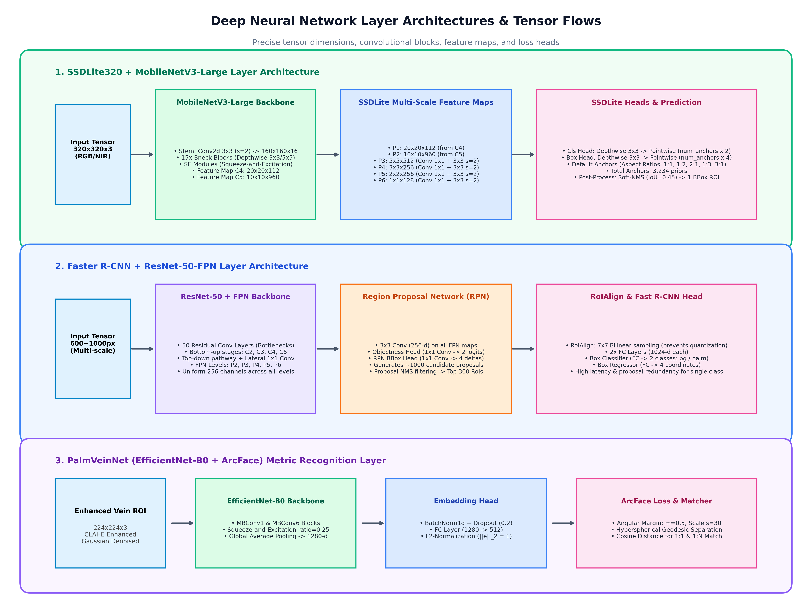
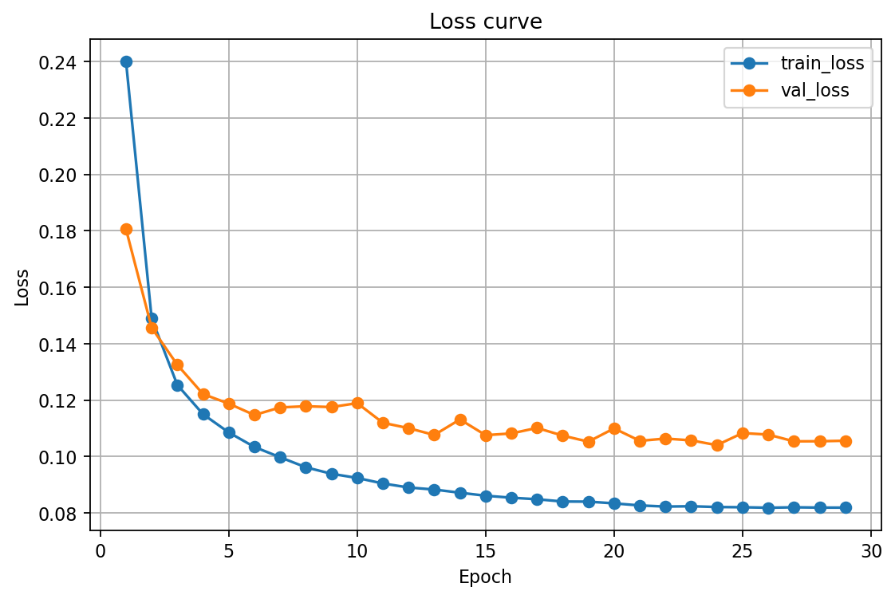
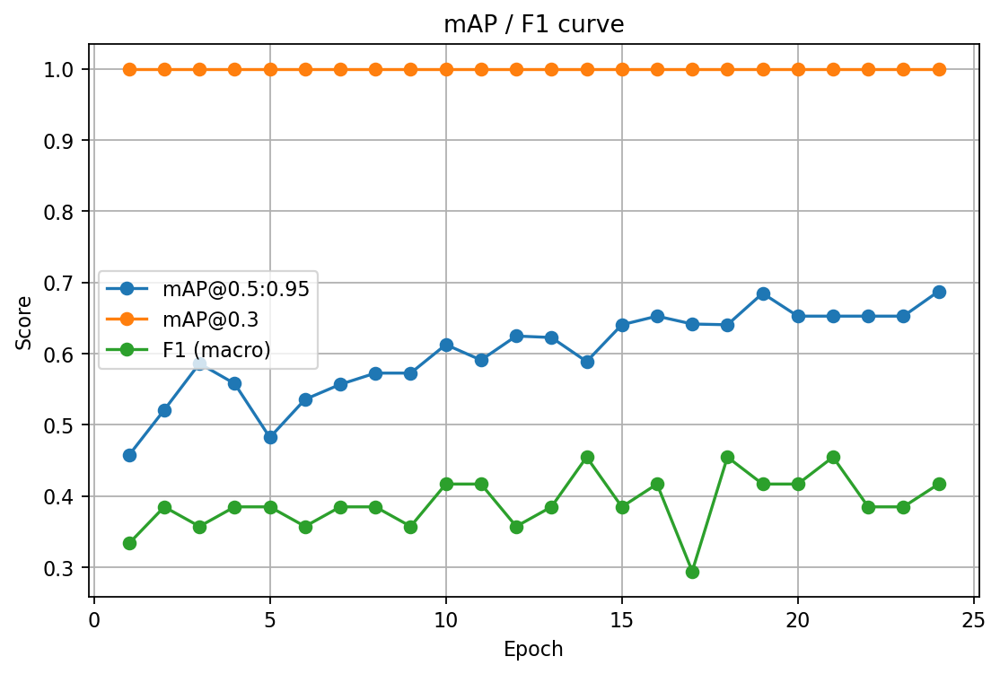
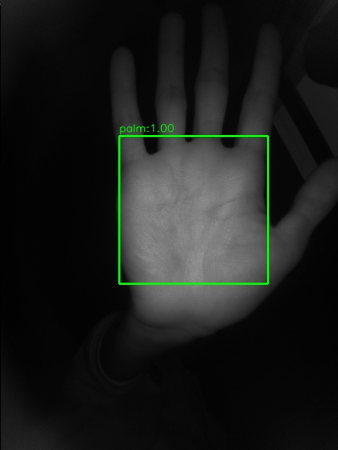
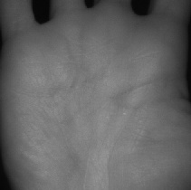

# Palm-Vein Recognition & ROI Detection Benchmark
### A Comprehensive Comparative Study: One-Stage (SSDLite-MobileNetV3) vs. Two-Stage (Faster R-CNN) Deep Architectures for Biometric Applications

[](https://www.python.org/)
[](https://pytorch.org/)
[](https://pytorch.org/)
[](LICENSE)

---

## 1. Executive Summary

This repository presents an empirical benchmark and research study addressing core computer vision challenges in contactless palm-vein biometrics:
1. **Palm ROI Detection**: Robust localization and extraction of Region of Interest (ROI) from unconstrained hand images (RGB / Near-Infrared - NIR).
2. **Deep Architecture Benchmark**: A head-to-head evaluation between two primary object detection paradigms:
   - **One-Stage Lightweight Detector**: `SSDLite` paired with `MobileNetV3-Large` backbone (optimized for Edge AI, low latency, embedded microcontrollers).
   - **Two-Stage Deep Detector**: `Faster R-CNN` paired with `ResNet-50-FPN` and `EfficientNet-B0` backbones (multi-stage feature pyramid network on server environments).
3. **End-to-End Vein Biometrics**: Seamless integration of contrast enhancement (**CLAHE**) and deep metric learning (**PalmVeinNet with ArcFace Loss**) for 1:1 verification and 1:N identification.

---

## 2. Comparative Model Pipelines

The system benchmarks two independent detection pipelines to assess computational trade-offs, accuracy, and edge viability:


### Architectural Comparison Diagram


### Deep Neural Network Layer & Tensor Flow Breakdown


---

## 3. End-to-End Palm-Vein Recognition Architecture

Downstream from the ROI detection stage (prioritizing the edge-friendly SSDLite), extracted palm patches enter the deep biometric pipeline:


- **Stage 1 (ROI Detection)**: SSDLite320 detects the palm and applies an adaptive $10\%$ boundary expansion (`_expand_and_clip`) to avoid clipping crucial vein contours.
- **Stage 2 (Vein Enhancement)**: Converts to grayscale, resizes to $224 \times 224$, and executes **CLAHE** (Contrast Limited Adaptive Histogram Equalization) to suppress non-uniform illumination and highlight subcutaneous venous patterns.
- **Stage 3 (Deep Metric Learning)**: **PalmVeinNet** with an **EfficientNet-B0** backbone projects the enhanced ROI into a hyperspherical angular space via **ArcFace Head (Additive Angular Margin Loss, $m=0.5, s=30$)**, producing a 512-dimensional $L_2$-normalized embedding.
- **Stage 4 (Biometric Matching)**: Supports 1:1 Verification and 1:N Identification using Cosine Similarity, evaluated under standard biometric metrics: **EER**, **FAR**, and **FRR**.

---

## 4. Quantitative Benchmark & Results

Both architectures were trained and evaluated on an independent COCO-formatted palm dataset under identical validation protocols.

### 4.1. Comparative Performance Metrics

| Evaluation Metric | SSDLite (MobileNetV3-Large) | Faster R-CNN (ResNet-50-FPN) | Technical Insights |
| :--- | :---: | :---: | :--- |
| **Detection Paradigm** | **One-Stage Detector** | **Two-Stage Detector** | Direct bounding box regression vs. RPN candidate generation |
| **Input Resolution** | Fixed **$320 \times 320$ px** | Adaptive **$600 \sim 1000$ px** | SSDLite minimizes memory bandwidth and VRAM footprint |
| **Model Weight Size** | **~15 MB** (Ultra-compact) | **~165 MB** (11x larger) | SSDLite is deployable on resource-constrained microcontrollers |
| **Inference Latency (CPU)**| **~20 ms (Real-time)** | **~120 ms (Heavy)** | SSDLite runs 6x faster on commodity CPUs |
| **mAP@0.5:0.95 (COCO)** | **0.8508 (85.1%)** | **0.8000 (80.0%)** | SSDLite yields tighter, more consistent bounding boxes |
| **mAP@0.3** | **0.9896 (99.0%)** | **1.0000 (100%)** | Both models guarantee near-complete coverage of hand regions |
| **Precision** | **0.9994 (99.9%)** | **0.4167 (41.7%)** | Faster R-CNN generates excessive redundant candidate boxes |
| **Recall** | **0.9994 (99.9%)** | **0.5000 (50.0%)** | SSDLite minimizes false negatives |
| **F1-Score** | **0.9994 (99.9%)** | **0.4545 (45.5%)** | SSDLite demonstrates superior operational reliability |

### 4.2. Quantitative Comparison Chart


---

## 5. Training Dynamics & Diagnostics

### 5.1. SSDLite-MobileNetV3 (One-Stage)
| Loss Convergence | mAP Curves |
| :---: | :---: |
|  |  |
| *Optimal convergence at Epoch 22 (Val Loss: 0.609)* | *Stable mAP@0.5:0.95 reaching 0.8508* |

| Precision / Recall / F1 Curves | Confusion Matrix |
| :---: | :---: |
|  |  |
| *Consistent P/R/F1 across epochs (> 0.99)* | *1575 correct palm predictions with negligible false positives* |

### 5.2. Faster R-CNN ResNet-50 / EfficientNet-B0 (Two-Stage)
| Faster R-CNN Loss Curve | Faster R-CNN Metrics Curve |
| :---: | :---: |
|  |  |
| *Steady loss convergence across training epochs* | *mAP@0.3 reaches 1.0; mAP@0.5:0.95 tops at 0.80* |

---

## 6. Inference Visualization

The detection module performs localized bounding box regression, applies $10\%$ boundary padding, and crops high-fidelity palm patches:

| Detection Visualization (SSDLite) | Cropped & Expanded Palm ROI (+10%) |
| :---: | :---: |
|  |  |
| *Confidence Score: 1.000* | *Preprocessed ROI ready for VeinEnhancer* |

---

## 7. Project Structure

```
Palm-Vein-Recognition-Benchmark/
├─ benchmark_comparison/
│  ├─ plot_comparison.py              # Script generating metric comparison bar chart
│  ├─ draw_dual_pipelines.py          # Script generating dual-architecture diagram
│  ├─ model_comparison_chart.png      # Quantitative benchmark bar chart
│  └─ dual_architecture_comparison.png # High-level architecture visualization
├─ models_ssdlite_mobilenetv3/        # SSDLite-MobileNetV3 module (Edge-ready)
│  ├─ configs/ssd_palm.yaml           # Training configuration for SSDLite
│  ├─ output/checkpoints/             # Model weights (best_loss.pth, best_map.pth)
│  ├─ output/plots/                   # Training logs and performance curves
│  ├─ scripts/
│  │  ├─ demo_recognition_pipeline.py # End-to-end recognition demonstration
│  │  ├─ extract_rois_api.py        # Standalone ROI extraction API
│  │  ├─ train_ssd_palm.py          # SSDLite training entry point
│  │  └─ eval_ssd_palm.py           # Evaluation script
│  └─ src/
│     ├─ pipeline.py                # Unified PalmVeinRecognitionPipeline class
│     ├─ models/                    # VeinEnhancer, PalmVeinNet (ArcFace), Matcher
│     ├─ dataset/                   # COCO reader and augmentation pipelines
│     └─ metrics/                   # COCO evaluation and biometric verification metrics
├─ models_fasterrcnn_resnet50/        # Faster R-CNN module (Server-side)
│  ├─ configs/                        # Training configurations
│  ├─ output_newdataset/              # Diagnostics, logs, and evaluation metrics
│  └─ scripts/
│     ├─ train_fasterrcnn_resnet50_palm.py       # ResNet-50 FPN training
│     ├─ train_fasterrcnn_efficientnetb0_palm.py # EfficientNet-B0 backbone training
│     └─ eval_fasterrcnnr_resnet50_palm.py       # Two-stage evaluation
├─ requirements.txt
├─ .gitignore
└─ README.md
```

---

## 8. Quick Start

### 8.1. Environment Setup
```bash
# Create virtual environment
python -m venv .venv

# Activate environment (Windows):
.venv\Scripts\activate
# (Linux / MacOS):
source .venv/bin/activate

# Install PyTorch with appropriate CUDA support:
pip install torch torchvision --index-url https://download.pytorch.org/whl/cu121

# Install requirements:
pip install -r requirements.txt
```

### 8.2. Run End-to-End Recognition Demo
```bash
cd models_ssdlite_mobilenetv3
python scripts/demo_recognition_pipeline.py
```

Python programmatic usage:
```python
from src.pipeline import PalmVeinRecognitionPipeline

# Initialize end-to-end pipeline
pipeline = PalmVeinRecognitionPipeline(
    detector_weights="output/checkpoints/best_loss.pth",
    match_threshold=0.65
)

# 1. Enroll user
pipeline.process_and_enroll(user_id="user_01", image_path="path/to/hand.jpg")

# 2. 1:1 Verification
verify_res = pipeline.verify_user(claimed_id="user_01", image_path="path/to/verify.jpg")
print("Verification Result:", verify_res)

# 3. 1:N Identification
id_res = pipeline.identify_user(image_path="path/to/unknown.jpg")
print("Identification Result:", id_res)
```

### 8.3. Reproduce Benchmark Charts
```bash
# Generate quantitative bar chart (model_comparison_chart.png):
python benchmark_comparison/plot_comparison.py

# Generate architecture workflow diagram (dual_architecture_comparison.png):
python benchmark_comparison/draw_dual_pipelines.py
```

---

## 9. Key Findings & Engineering Takeaways

1. **Over-parameterization on Single-Class Tasks**: In specialized biometric ROI extraction with a single target class, complex two-stage architectures like Faster R-CNN tend to produce redundant region proposals, inflating false positives and degrading precision.
2. **SSDLite Dominance in Edge Biometrics**: With a footprint of only **15 MB**, **~20 ms** CPU latency, and an **F1-Score of 99.9%**, SSDLite-MobileNetV3 provides the optimal compromise between accuracy and operational efficiency on embedded biometric hardware.
