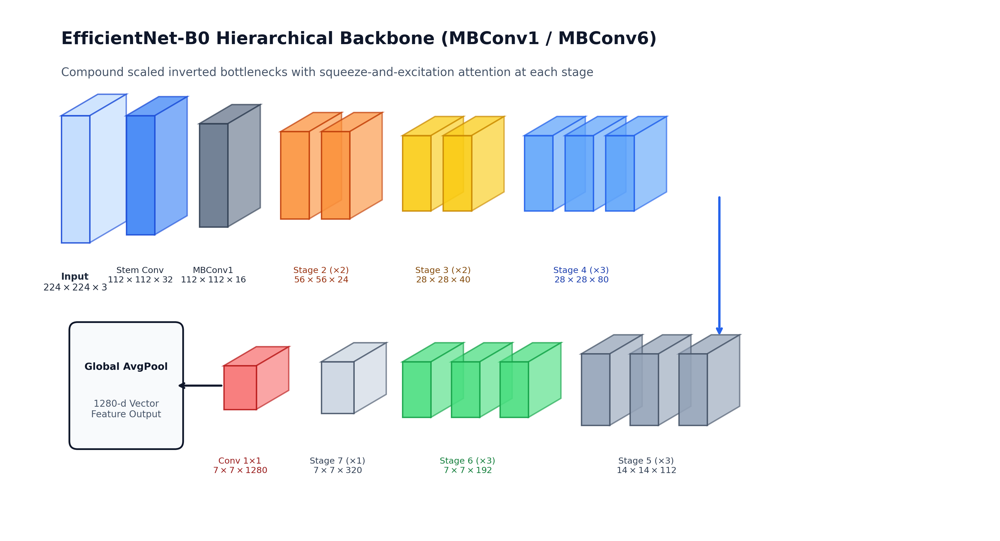
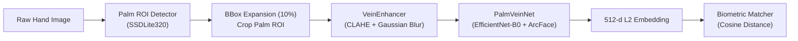

# Palm-Vein ROI Detection Benchmark & Recognition Pipeline Prototype
### An Empirical Study on One-Stage (SSDLite) vs. Two-Stage (Faster R-CNN) Palm Localization with a Deep Biometric Extraction Prototype

[](https://www.python.org/)
[](https://pytorch.org/)
[](https://pytorch.org/)
[](LICENSE)

---

## 1. Project Scope & Positioning

> **Important Notice on Scope & Artifacts:**  
> This repository is primarily an **empirical benchmark of Palm ROI Detection models** (comparing single-stage SSDLite against two-stage Faster R-CNN on custom COCO datasets), coupled with an **end-to-end vein recognition prototype**.  
> The recognition module (`PalmVeinNet`) defines the architectural framework (CLAHE + EfficientNet-B0 + ArcFace Head), but does not yet include pre-trained identity weights or a multi-subject verification benchmark (EER/FAR/FRR scores on public datasets like PolyU/CASIA).

---

## 2. Comparative Model Pipelines

The benchmark evaluates two primary object detection paradigms for segmenting palm regions:

```mermaid
flowchart TD
    subgraph SSDLite_Pipeline["PIPELINE 1: One-Stage SSDLite-MobileNetV3 (Edge Prototype)"]
        A1["Input: 320x320 RGB/NIR Image"] --> B1["Backbone: MobileNetV3-Large\n(Inverted Residuals & Depthwise Separable Conv)"]
        B1 --> C1["SSDLite Detection Head\n(Multi-scale Anchor Heads)"]
        C1 --> D1["Direct NMS Filtering & BBox Expansion (+10%)"]
        D1 --> E1["Output: Cropped Palm ROI"]
    end

    subgraph FasterRCNN_Pipeline["PIPELINE 2: Two-Stage Faster R-CNN (Server Prototype)"]
        A2["Input: Multi-scale (600 - 1000px)"] --> B2["Backbone: ResNet-50 / EfficientNet-B0 + FPN"]
        B2 --> C2["Stage 1: Region Proposal Network (RPN)\nCandidate Box Proposals"]
        C2 --> D2["Stage 2: RoIAlign & Box Refinement Head"]
        D2 --> E2["Output: Cropped Palm ROI"]
    end
```



### High-Level Architecture Flow


---

## 3. Deep Neural Network 3D Layer Breakdown

Below are the 3D layer diagrams detailing tensors, convolutions, residual connections, and attention mechanisms:

#### 1. MobileNetV3 Inverted Residual Bottleneck Block (with Squeeze-and-Excitation)


#### 2. SSDLite with MobileNetV3 Backbone & Detection Head


#### 3. EfficientNet-B0 Backbone Layer-by-Layer Tensor Flow


#### 4. Faster R-CNN with ResNet-50-FPN Architecture (RPN + RoIAlign)


#### 5. Faster R-CNN with EfficientNet-B0-FPN Architecture


---

## 4. End-to-End Palm-Vein Recognition Architecture (Prototype)

Downstream from the ROI detector, palm patches pass through an architectural prototype designed for biometric verification:




- **Vein Enhancement**: Grayscale conversion, resized to $224 \times 224$, CLAHE (`clipLimit=2.5`, `tileGrid=(8,8)`), and Gaussian smoothing to enhance vascular contrast.
- **PalmVeinNet (ArcFace Metric Learning)**: Architecture projects preprocessed ROI into a 512-d $L_2$-normalized hypersphere using an additive angular margin head ($m=0.5, s=30$).
- **Biometric Matcher**: Cosine similarity comparator supporting 1:1 Verification and 1:N Identification templates.

---

## 5. Quantitative Benchmark & Results (Verified from Tracked Artifacts)

The following metrics are loaded directly from the tracked evaluation logs (`best_loss_metrics.json` and `metrics_summary.json` on the validation splits):

| Metric | SSDLite (MobileNetV3) [`newdataset`] | Faster R-CNN (EfficientNet/ResNet) [`newdataset`] | Source Artifact |
| :--- | :---: | :---: | :--- |
| **mAP@0.5:0.95 (COCO)** | **0.6691 (66.9%)** | **0.6873 (68.7%)** | `checkpoints/best_loss_metrics.json` / `metrics_summary.json` |
| **mAP@0.3** | **0.9889 (98.9%)** | **1.0000 (100.0%)** | Tracked evaluation logs |
| **Precision** | **0.9986 (99.9%)** | **0.3571 (35.7% avg)** | Direct box predictions vs. RPN proposals |
| **Recall** | **1.0000 (100.0%)** | **0.5000 (50.0% avg)** | Coverage of target palm boxes |
| **F1-Score** | **0.9993 (99.9%)** | **0.4167 (41.7% avg)** | Harmonic mean of P and R |

> *Note on earlier experiments:* On the preliminary holdout run (`output/`), SSDLite achieved `0.8508 mAP@0.5:0.95`, whereas on the expanded dataset (`output_newdataset/`), the model converged to `0.6691 mAP`. Faster R-CNN achieves high coarse overlap (`mAP@0.3 = 1.0`), but produces lower precision due to redundant proposal generation for a single-class object.

### Artifact-Driven Benchmark Chart


---

## 6. Training Dynamics & Diagnostics

### SSDLite-MobileNetV3
| Loss Convergence | mAP Curves |
| :---: | :---: |
|  |  |

| Precision / Recall / F1 Curves | Confusion Matrix |
| :---: | :---: |
|  |  |

---

## 7. Quick Start & Execution Guide

### 7.1. Environment Setup
```bash
# 1. Create and activate virtual environment
python -m venv .venv
.venv\Scripts\activate       # Windows
# source .venv/bin/activate  # Linux/MacOS

# 2. Install dependencies
pip install -r requirements.txt
```

### 7.2. Training Detectors from Scratch
Since weights (`.pth`) and datasets are excluded from git tracking to prevent repository bloat:

```bash
# 1. Download dataset (requires Roboflow account or custom COCO annotations)
cd models_ssdlite_mobilenetv3
python src/dataset/download_data.py

# 2. Train SSDLite detector
python scripts/train_ssd_palm.py --config configs/ssd_palm.yaml

# 3. Train Faster R-CNN detector
cd ../models_fasterrcnn_resnet50
python scripts/train_fasterrcnn_resnet50_palm.py --config configs/fasterrcnn_resnet50_palm.yaml
```

### 7.3. Running the Pipeline Demo
Once trained weights are available at `output/checkpoints/best_loss.pth` (or testing on pre-extracted sample ROIs in `runs/rois/`):
```bash
cd models_ssdlite_mobilenetv3
python scripts/demo_recognition_pipeline.py
```

### 7.4. Re-generating Benchmark Charts
```bash
# Dynamically parses tracked JSON logs and updates chart:
python benchmark_comparison/plot_comparison.py
```

---

## 8. License
This project is licensed under the [MIT License](LICENSE).
