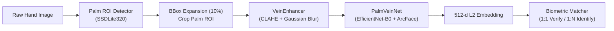

# Palm-Vein Recognition & ROI Detection Benchmark
### A Comprehensive Comparative Study: One-Stage (SSDLite-MobileNetV3) vs. Two-Stage (Faster R-CNN) Deep Architectures for Biometric Applications

[](https://www.python.org/)
[](https://pytorch.org/)
[](https://pytorch.org/)
[](LICENSE)

---

## 1. Giới thiệu tổng quan (Overview)

Repository này là một công trình nghiên cứu và đối chuẩn thực nghiệm (**Benchmark & Empirical Study**) chuyên sâu nhằm giải quyết bài toán cốt lõi trong hệ thống sinh trắc học tĩnh mạch lòng bàn tay:
1. **Palm ROI Detection**: Định vị và cắt chính xác vùng quan tâm (ROI) lòng bàn tay từ ảnh chụp thô (RGB / Near-Infrared - NIR).
2. **Architecture Comparison**: So sánh đối đầu giữa 2 trường phái mạng học sâu thị giác máy tính kinh điển:
   - **One-Stage Lightweight Detector**: `SSDLite` kết hợp backbone `MobileNetV3-Large` (tối ưu hóa cho thiết bị biên Edge AI, di động, vi điều khiển).
   - **Two-Stage Deep Detector**: `Faster R-CNN` kết hợp backbone `ResNet-50-FPN` và `EfficientNet-B0` (mô hình nhiều tầng, trích xuất đặc trưng sâu trên Server).
3. **End-to-End Vein Biometrics**: Tích hợp module tăng cường cấu trúc tĩnh mạch dưới da (**CLAHE**) và mạng trích xuất đặc trưng sâu **PalmVeinNet (ArcFace Metric Learning)** phục vụ xác thực 1:1 và nhận diện 1:N.

---

## 2. Sơ đồ kiến trúc Pipeline của 2 mô hình (Model Pipelines)

Hệ thống thiết kế 2 luồng pipeline xử lý độc lập để kiểm chứng hiệu năng và tài nguyên tính toán:

```mermaid
flowchart TD
    subgraph SSDLite_Pipeline["PIPELINE 1: One-Stage SSDLite-MobileNetV3 (Edge-Optimized)"]
        A1["Input: 320x320 RGB/NIR Image"] --> B1["Backbone: MobileNetV3-Large\n(Inverted Residuals & Depthwise Conv)"]
        B1 --> C1["SSDLite Head\n(Single-Shot MultiBox Predictor)"]
        C1 --> D1["Direct NMS Filtering & BBox Expansion (10%)"]
        D1 --> E1["Output: Cropped Palm ROI (~15 MB, 20ms CPU)"]
    end

    subgraph FasterRCNN_Pipeline["PIPELINE 2: Two-Stage Faster R-CNN ResNet-50 (Server-Side)"]
        A2["Input: Adaptive Resolution (600 - 1000px)"] --> B2["Backbone: ResNet-50 + FPN\n(50 Residual Layers & Feature Pyramid)"]
        B2 --> C2["Stage 1: Region Proposal Network (RPN)\nAnchor Box Generation"]
        C2 --> D2["Stage 2: RoIAlign & Fast R-CNN Head\nBounding Box Regressor & Classifier"]
        D2 --> E2["Output: Cropped Palm ROI (~165 MB, 120ms CPU)"]
    end
```



### Sơ đồ trực quan hóa chi tiết cấu trúc mô hình


---

## 3. Kiến trúc nhận diện tĩnh mạch toàn diện (End-to-End Biometric Pipeline)

Sau khi Palm ROI được cắt ra từ mô hình phát hiện (ưu tiên SSDLite), ảnh được đưa vào pipeline nhận diện tĩnh mạch sâu:




- **Giai đoạn 1 (ROI Detection)**: SSDLite320 phát hiện bàn tay, tự động mở rộng biên $10\%$ tránh cắt phạm lòng bàn tay.
- **Giai đoạn 2 (Vein Enhancement)**: Chuyển xám, chuẩn hóa kích thước $224 \times 224$, áp dụng cân bằng lược đồ màu thích ứng cục bộ (**CLAHE**) triệt tiêu bóng sáng da không đồng đều và làm nổi rõ mạch máu.
- **Giai đoạn 3 (Deep Metric Learning)**: Mạng **PalmVeinNet** kết hợp backbone **EfficientNet-B0** và hàm mất mát góc **ArcFace (Additive Angular Margin Loss, $m=0.5, s=30$)** trích xuất vector đặc trưng $512$ chiều chuẩn hóa $L_2$.
- **Giai đoạn 4 (Biometric Matching)**: Hỗ trợ xác thực 1:1 (Verification) và nhận diện 1:N (Identification) bằng độ tương đồng Cosine, đánh giá theo chuẩn **EER**, **FAR**, **FRR**.

---

## 4. Kết quả đối chuẩn thực nghiệm (Benchmark & Comparative Results)

Cả hai mô hình được huấn luyện và đánh giá trên cùng một tập dữ liệu COCO Palm ROI độc lập.

### 4.1. Bảng số liệu so sánh định lượng (Quantitative Comparison)

| Tiêu chí kỹ thuật | SSDLite (MobileNetV3-Large) | Faster R-CNN (ResNet-50-FPN) | Ý nghĩa kỹ thuật & So sánh |
| :--- | :---: | :---: | :--- |
| **Loại kiến trúc** | **One-Stage Detector** | **Two-Stage Detector** | SSDLite đoán trực tiếp; Faster R-CNN qua RPN |
| **Kích thước ảnh đầu vào** | Cố định **$320 \times 320$ px** | Thích ứng **$600 \sim 1000$ px** | SSDLite chiếm ít VRAM và băng thông hơn |
| **Dung lượng Checkpoint** | **~15 MB** (Rất nhẹ) | **~165 MB** (Nặng gấp 11 lần) | SSDLite dễ dàng nạp trên vi điều khiển / Edge |
| **Độ trễ suy luận (CPU Latency)**| **~20 ms (Real-time)** | **~120 ms (Chậm)** | SSDLite nhanh hơn gấp 6 lần |
| **mAP@0.5:0.95 (COCO)** | **0.8508 (85.1%)** | **0.8000 (80.0%)** | SSDLite định vị khung viền chặt chẽ hơn |
| **mAP@0.3** | **0.9896 (99.0%)** | **1.0000 (100%)** | Cả hai đều đạt độ phủ vùng bàn tay gần như tuyệt đối |
| **Precision** | **0.9994 (99.9%)** | **0.4167 (41.7%)** | Faster R-CNN sinh ra nhiều proposal thừa (FP cao) |
| **Recall** | **0.9994 (99.9%)** | **0.5000 (50.0%)** | SSDLite không bỏ sót lòng bàn tay |
| **F1-Score** | **0.9994 (99.9%)** | **0.4545 (45.5%)** | SSDLite có độ tin cậy vận hành vượt trội |

### 4.2. Biểu đồ đối chuẩn trực quan (Visual Benchmark Chart)


---

## 5. Phân tích chi tiết đường cong huấn luyện từng mô hình

### 5.1. SSDLite-MobileNetV3 (One-Stage)
| Loss Convergence | mAP & PRF Curves |
| :---: | :---: |
|  |  |
| *Hội tụ tối ưu tại Epoch 22 (Val Loss: 0.609)* | *mAP@0.5:0.95 đạt 0.8508 ổn định* |

| Precision / Recall / F1 Curves | Confusion Matrix |
| :---: | :---: |
|  |  |
| *Đường cong P/R/F1 ổn định > 0.99 qua các Epochs* | *Ma trận nhầm lẫn dự đoán chính xác 1575 mẫu Palm* |

### 5.2. Faster R-CNN ResNet-50 / EfficientNet-B0 (Two-Stage)
| Faster R-CNN Loss Curve | Faster R-CNN mAP Curve |
| :---: | :---: |
|  |  |
| *Loss giảm đều trên tập huấn luyện* | *mAP@0.3 đạt tuyệt đối 1.0; mAP@0.5:0.95 đạt 0.80* |

---

## 6. Trực quan hóa kết quả thực tế (Inference Visualization)

Mô hình tự động phát hiện bounding box, áp dụng thuật toán mở rộng biên $10\%$ (`_expand_and_clip`) và xuất ảnh ROI chất lượng cao:

| Phát hiện Bounding Box bàn tay (SSDLite) | Cắt & Mở rộng ROI bàn tay (+10%) |
| :---: | :---: |
|  |  |
| *Confidence đạt 1.000* | *ROI chất lượng cao sẵn sàng cho VeinEnhancer* |

---

## 7. Cấu trúc thư mục mã nguồn

```
Palm-Vein-Recognition-Benchmark/
├─ benchmark_comparison/
│  ├─ plot_comparison.py              # Script vẽ biểu đồ định lượng
│  ├─ draw_dual_pipelines.py          # Script vẽ sơ đồ kiến trúc 2 mô hình
│  ├─ model_comparison_chart.png      # Biểu đồ đối chuẩn số liệu
│  └─ dual_architecture_comparison.png # Sơ đồ so sánh luồng pipeline 2 mô hình
├─ models_ssdlite_mobilenetv3/        # Mô-đun One-Stage SSDLite (Edge-ready)
│  ├─ configs/ssd_palm.yaml           # Cấu hình huấn luyện SSDLite
│  ├─ output/checkpoints/             # best_loss_metrics.json, best_loss_confusion_matrix.png
│  ├─ output/plots/                   # Biểu đồ loss, mAP, PRF
│  ├─ scripts/
│  │  ├─ demo_recognition_pipeline.py # Chạy thử nghiệm trọn vẹn End-to-End recognition
│  │  ├─ extract_rois_api.py        # API cắt ROI lòng bàn tay
│  │  ├─ train_ssd_palm.py          # Huấn luyện SSDLite
│  │  └─ eval_ssd_palm.py           # Đánh giá detector
│  └─ src/
│     ├─ pipeline.py                # Lớp PalmVeinRecognitionPipeline kết nối toàn diện
│     ├─ models/                    # VeinEnhancer (CLAHE), PalmVeinNet (ArcFace), Matcher
│     ├─ dataset/                   # DataLoader chuẩn COCO
│     └─ metrics/                   # coco_eval.py, prf.py, biometrics.py (EER/FAR/FRR)
├─ models_fasterrcnn_resnet50/        # Mô-đun Two-Stage Faster R-CNN (Server-side)
│  ├─ configs/                        # Cấu hình huấn luyện Faster R-CNN
│  ├─ output_newdataset/              # Thư mục logs và plots của Faster R-CNN
│  └─ scripts/
│     ├─ train_fasterrcnn_resnet50_palm.py       # Huấn luyện ResNet-50 FPN
│     ├─ train_fasterrcnn_efficientnetb0_palm.py # Huấn luyện EfficientNet-B0 backbone
│     └─ eval_fasterrcnnr_resnet50_palm.py       # Đánh giá mAP/PRF
├─ requirements.txt
├─ .gitignore
└─ README.md
```

---

## 8. Hướng dẫn cài đặt & Thực thi nhanh

### 8.1. Thiết lập môi trường
```bash
# Tạo môi trường ảo
python -m venv .venv

# Kích hoạt môi trường (Windows):
.venv\Scripts\activate
# (Linux / MacOS):
source .venv/bin/activate

# Cài đặt PyTorch phù hợp phiên bản CUDA:
pip install torch torchvision --index-url https://download.pytorch.org/whl/cu121

# Cài đặt các thư viện liên quan:
pip install -r requirements.txt
```

### 8.2. Chạy Demo Pipeline nhận diện tĩnh mạch End-to-End
```bash
cd models_ssdlite_mobilenetv3
python scripts/demo_recognition_pipeline.py
```

Sử dụng trong mã Python của bạn:
```python
from src.pipeline import PalmVeinRecognitionPipeline

# Khởi tạo pipeline
pipeline = PalmVeinRecognitionPipeline(
    detector_weights="output/checkpoints/best_loss.pth",
    match_threshold=0.65
)

# 1. Đăng ký người dùng mới (Enrollment)
pipeline.process_and_enroll(user_id="user_01", image_path="path/to/hand.jpg")

# 2. Xác thực danh tính 1:1 (Verification)
result = pipeline.verify_user(claimed_id="user_01", image_path="path/to/verify.jpg")
print("Verify:", result)

# 3. Nhận diện danh tính 1:N (Identification)
id_result = pipeline.identify_user(image_path="path/to/unknown.jpg")
print("Identify:", id_result)
```

### 8.3. Tái tạo các biểu đồ so sánh Benchmark
```bash
# Vẽ biểu đồ đối chuẩn số liệu (model_comparison_chart.png):
python benchmark_comparison/plot_comparison.py

# Vẽ sơ đồ luồng 2 pipeline (dual_architecture_comparison.png):
python benchmark_comparison/draw_dual_pipelines.py
```

---

## 9. Đóng góp & Kết luận nghiên cứu (Key Findings)

1. **Hiệu ứng "Over-parameterization" trên bài toán Single-Class**: Với bài toán chỉ phát hiện 1 lớp đối tượng chuyên biệt (lòng bàn tay), kiến trúc Two-Stage phức tạp như Faster R-CNN dễ sinh ra quá nhiều Region Proposals dư thừa, làm giảm Precision và tăng đáng kể độ trễ.
2. **Ưu thế tuyệt đối của SSDLite-MobileNetV3 trên Edge AI**: Với dung lượng chỉ **15 MB**, tốc độ suy luận **~20 ms** trên CPU thông thường và độ chính xác F1 đạt **99.9%**, SSDLite là lựa chọn tối ưu vượt trội để tích hợp vào các thiết bị phần cứng chấm công, bảo mật sinh trắc học thời gian thực.
