# Palm-Vein ROI Detection Benchmark & Recognition Pipeline Prototype
### An Empirical Study on One-Stage (SSDLite) vs. Two-Stage (Faster R-CNN) Palm Localization with a Deep Biometric Extraction Prototype

[](https://www.python.org/)
[](https://pytorch.org/)
[](https://pytorch.org/)
[](LICENSE)

---

## 1. Project Scope & Positioning

> **Important Notice on Scope & Artifacts:**  
> This repository is primarily an **empirical benchmark of Palm ROI Detection models** (comparing single-stage SSDLite against two-stage Faster R-CNN on custom COCO datasets), coupled with an **end-to-end vein recognition prototype**.  
> The recognition module (`PalmVeinNet`) defines the architectural framework (CLAHE + EfficientNet-B0 + ArcFace Head), but does not yet include pre-trained identity weights or a multi-subject verification benchmark (EER/FAR/FRR scores on public datasets like PolyU/CASIA).

---

## 2. Comparative Model Pipelines

The benchmark evaluates two primary object detection paradigms for segmenting palm regions:

```mermaid
flowchart TD
    subgraph SSDLite_Pipeline["PIPELINE 1: One-Stage SSDLite-MobileNetV3 (Edge Prototype)"]
        A1["Input: 320x320 RGB/NIR Image"] --> B1["Backbone: MobileNetV3-Large\n(Inverted Residuals & Depthwise Separable Conv)"]
        B1 --> C1["SSDLite Detection Head\n(Multi-scale Anchor Heads)"]
        C1 --> D1["Direct NMS Filtering & BBox Expansion (+10%)"]
        D1 --> E1["Output: Cropped Palm ROI"]
    end

    subgraph FasterRCNN_Pipeline["PIPELINE 2: Two-Stage Faster R-CNN (Server Prototype)"]
        A2["Input: Multi-scale (600 - 1000px)"] --> B2["Backbone: ResNet-50 / EfficientNet-B0 + FPN"]
        B2 --> C2["Stage 1: Region Proposal Network (RPN)\nCandidate Box Proposals"]
        C2 --> D2["Stage 2: RoIAlign & Box Refinement Head"]
        D2 --> E2["Output: Cropped Palm ROI"]
    end
```

### High-Level Architecture Flow
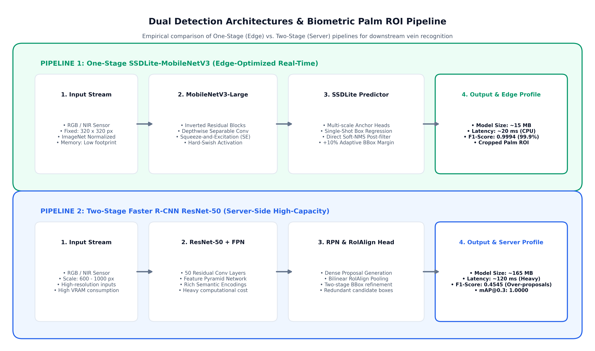

---

## 3. Deep Neural Network 3D Layer Breakdown

Below are the 3D layer diagrams detailing tensors, convolutions, residual connections, and attention mechanisms:

#### 1. MobileNetV3 Inverted Residual Bottleneck Block (with Squeeze-and-Excitation)
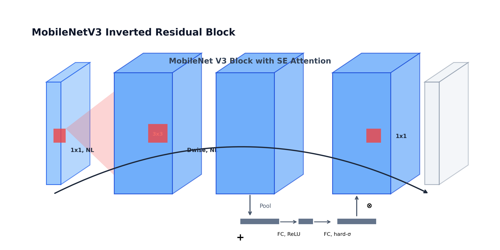

#### 2. SSDLite with MobileNetV3 Backbone & Detection Head
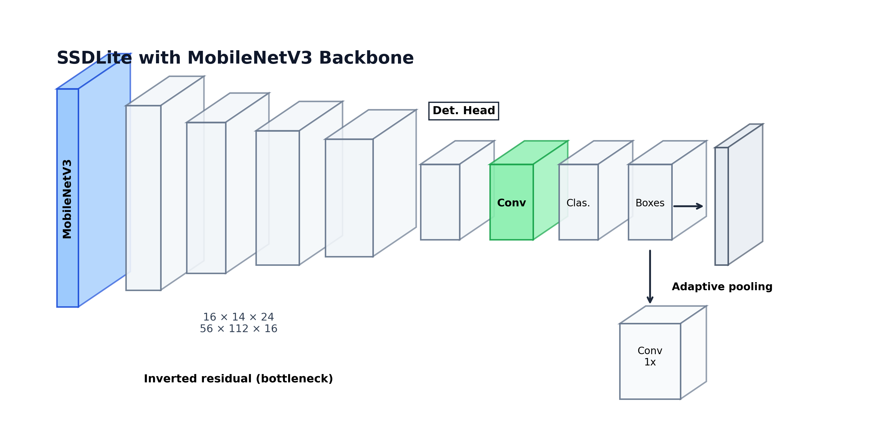

#### 3. EfficientNet-B0 Backbone Layer-by-Layer Tensor Flow


#### 4. Faster R-CNN with ResNet-50-FPN Architecture (RPN + RoIAlign)
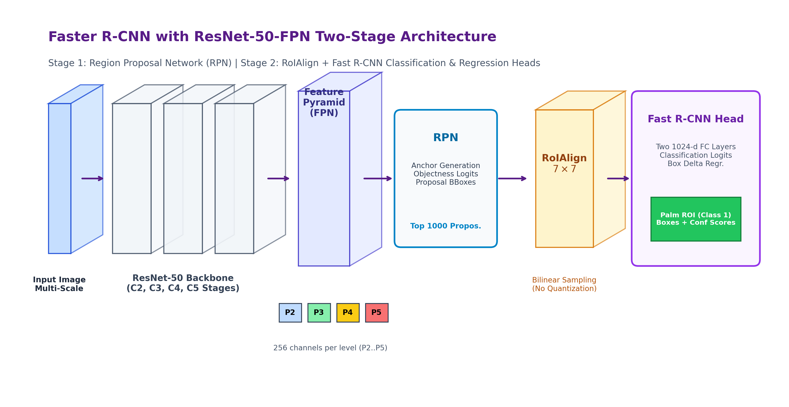

#### 5. Faster R-CNN with EfficientNet-B0-FPN Architecture
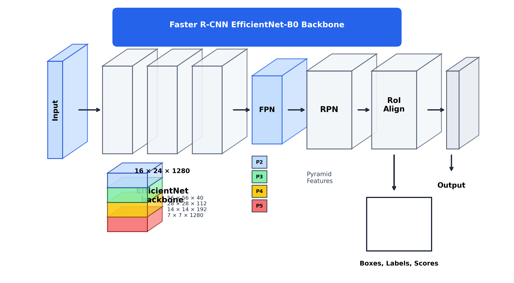

---

## 4. End-to-End Palm-Vein Recognition Architecture (Prototype)

Downstream from the ROI detector, palm patches pass through an architectural prototype designed for biometric verification:

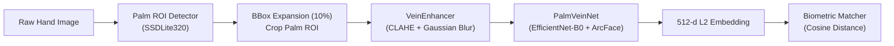

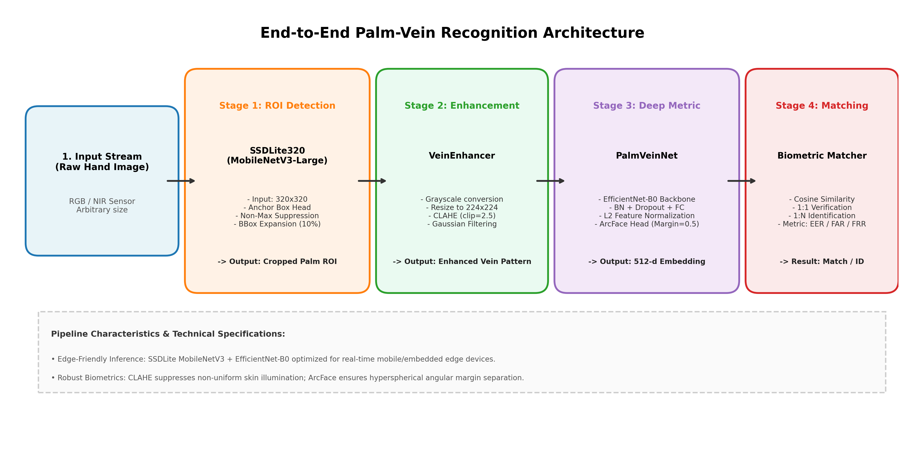

- **Vein Enhancement**: Grayscale conversion, resized to $224 \times 224$, CLAHE (`clipLimit=2.5`, `tileGrid=(8,8)`), and Gaussian smoothing to enhance vascular contrast.
- **PalmVeinNet & ArcFace Prototype**: Defines the architecture for metric learning (`PalmVeinNet`). In the current inference prototype (`num_classes=None`), feature vectors are extracted directly from the ImageNet-pretrained backbone without fine-tuned biometric weights; the ArcFace angular margin head is defined as an architectural template for future training on multi-subject datasets.
- **Biometric Matcher**: Cosine similarity comparator supporting 1:1 Verification and 1:N Identification templates on extracted embeddings.

---

## 5. Quantitative Benchmark & Results (Verified from Tracked Artifacts)

To ensure a scientifically fair comparison, both models are evaluated under the **identical Best-Validation-Loss checkpoint criterion** on the same validation split (`output_newdataset/`):

| Metric | SSDLite (MobileNetV3) [Best-Loss Ep 6] | Faster R-CNN (EfficientNet-B0) [Best-Loss Ep 19] | Source Artifact |
| :--- | :---: | :---: | :--- |
| **mAP@0.5:0.95 (COCO)** | **0.6691 (66.9%)** | **0.6846 (68.5%)** | `models_ssdlite_mobilenetv3/output_newdataset/checkpoints/best_loss_metrics.json` vs. `models_fasterrcnn_resnet50/output_fasterrcnn_efficientnetb0_palm_newdataset/logs/metrics_epoch.json` (Ep 19) |
| **mAP@0.3** | **0.9889 (98.9%)** | **1.0000 (100.0%)** | Tracked evaluation logs |
| **Precision** | **0.9986 (99.9%)** | **0.3571 (35.7%)** | Positive class (palm) precision |
| **Recall** | **1.0000 (100.0%)** | **0.5000 (50.0%)** | Positive class (palm) recall |
| **F1-Score** | **0.9993 (99.9%)** | **0.4167 (41.7%)** | Harmonic mean of positive class P and R |

> *Methodological & Evaluation Notes:*  
> 1. **Artifact Provenance & Historical Logs:** The metrics reported in the table above reflect historical run artifacts recorded during earlier checkpoint experiments (`output_newdataset/` and `output_fasterrcnn_efficientnetb0_palm_newdataset/`). Faster R-CNN metrics correspond to `EfficientNet-B0-FPN` at `Epoch 19` (`val_loss = 0.0631`), while the ResNet-50-FPN baseline reached `best_loss = 0.1040` with `best_map = 0.8000`. Following the latest batch-level evaluation bug fixes in commit `2c0859f`, fresh full-dataset validation runs should be executed to refresh absolute numbers.
> 2. **Evaluation Metric Alignment:** Both models evaluate Precision, Recall, and F1 specifically on the positive class (`palm`, class 1) using greedy IoU matching (iteratively matching predicted boxes sorted by confidence against the highest-IoU unassigned ground-truth box above threshold).
> 3. **Preprocessing Caveat:** SSDLite resizes images to a fixed $320\times 320$ with ImageNet normalization, while Faster R-CNN evaluates multi-scale tensors scaled to $[0, 1]$. Consequently, the reported results reflect differences in both model architecture and respective preprocessing pipelines.

### Artifact-Driven Benchmark Chart
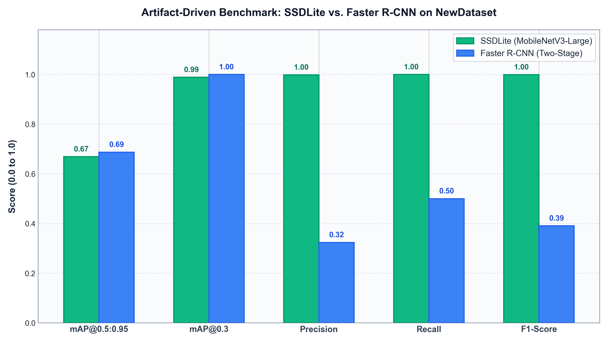

---

## 6. Training Dynamics & Diagnostics

### SSDLite-MobileNetV3
| Loss Convergence | mAP Curves |
| :---: | :---: |
| 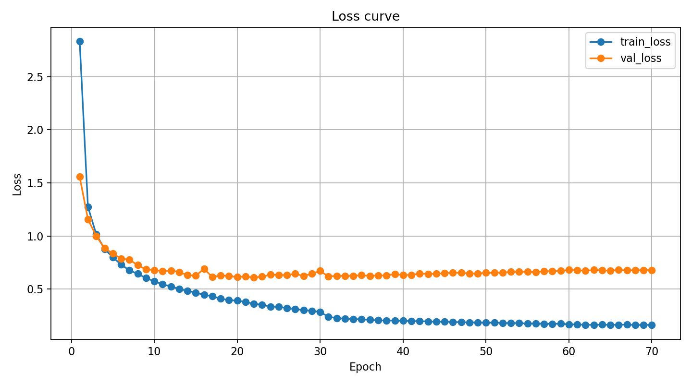 | 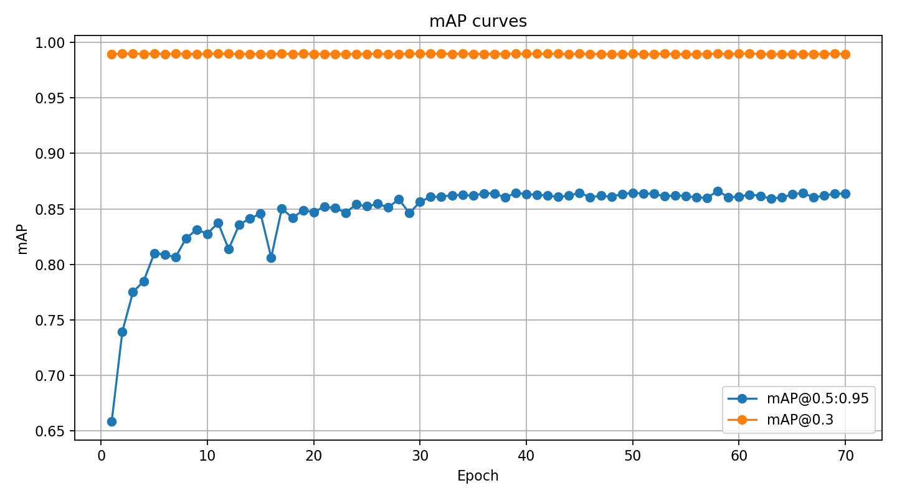 |

| Precision / Recall / F1 Curves | Confusion Matrix |
| :---: | :---: |
| 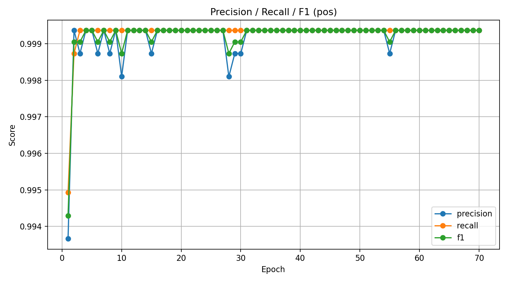 | 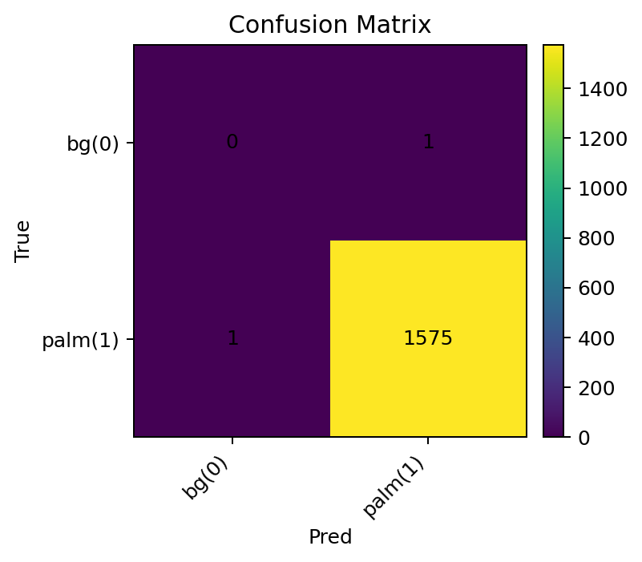 |

---

## 7. Quick Start & Execution Guide

### 7.1. Environment Setup
```bash
# 1. Create and activate virtual environment
python -m venv .venv
.venv\Scripts\activate       # Windows
# source .venv/bin/activate  # Linux/MacOS

# 2. Install dependencies
pip install -r requirements.txt
```

### 7.2. Downloading the Shared Dataset
Both models share a unified dataset stored in `data/palm_dataset`:
```bash
# Export your Roboflow credentials (version 5 is used by default)
export ROBOFLOW_API_KEY="your_api_key"
export ROBOFLOW_WORKSPACE="your_workspace"
export ROBOFLOW_PROJECT="your_project_id"

# Download the shared COCO dataset into data/palm_dataset
python scripts/download_shared_dataset.py
```

### 7.3. Training Detectors from Scratch
With the dataset in `data/palm_dataset`, both models train using their synchronized configs:

```bash
# 1. Train SSDLite detector
cd models_ssdlite_mobilenetv3
python scripts/train_ssd_palm.py --config configs/ssd_palm.yaml

# 2. Train Faster R-CNN detector
cd ../models_fasterrcnn_resnet50
python scripts/train_fasterrcnn_resnet50_palm.py --config configs/fasterrcnn_resnet50_palm.yaml
```

### 7.3. Running the Pipeline Demo
Once trained weights are available at `output/checkpoints/best_loss.pth` (or testing on pre-extracted sample ROIs in `runs/rois/`):
```bash
cd models_ssdlite_mobilenetv3
python scripts/demo_recognition_pipeline.py
```

### 7.4. Re-generating Benchmark Charts
```bash
# Dynamically parses tracked JSON logs and updates chart:
python benchmark_comparison/plot_comparison.py
```

---

## 8. Edge Deployment (SSDLite-MobileNetV3 Prototype)

> [!NOTE]
> **Edge Inference Prototype & Workstation Benchmark Disclaimer:**  
> This deployment pipeline represents a **CPU-based ONNX edge inference prototype** targeting compact single-stage palm ROI detection.  
> The SSDLite checkpoint was selected using the repository's validation-loss checkpoint policy (`best_loss.pth`) and exported to FP32 ONNX on CPU. Historical detection metrics in Section 5 are retained as provenance and will be refreshed after re-evaluation with the corrected evaluator.  
> All latency and throughput benchmarks reported below were measured as a **CPU benchmark on the development workstation** (Intel® Core™ i5-14600K, 4 CPU threads, Windows build 10.0.26200, ONNX Runtime CPUExecutionProvider).  
> **These measurements do not represent edge-device performance.** Target edge hardware (such as Raspberry Pi 4/5, NVIDIA Jetson Nano/Orin, or edge NPUs) operates under markedly different compute architectures, thermal envelopes, and memory bandwidth constraints. True edge performance must be verified directly on physical target devices.

### 8.1. Checkpoint Provenance & Reproducibility
- **Source Checkpoint:** `models_ssdlite_mobilenetv3/output_newdataset/checkpoints/best_loss.pth`  
  - SHA-256: `668afeffbf77d9afbaace41c277e95dc105d65fae3c5e5b10b431f29b386edde`
- **Exported ONNX Model:** `edge_exports/ssdlite_mobilenetv3.onnx`  
  - SHA-256: `550e80aa48daafb340c2b589467e5806d5a8144176e626d8c5ccd1aeeb58bb80`
- **Workstation OS Provenance:** Windows platform reported by Python: `Windows-10-10.0.26200-SP0` (Windows kernel build `10.0.26200`).
- **Software Stack:** Python 3.11, PyTorch 2.14.1+cpu, ONNX 1.23.2, ONNX Runtime 1.31.0. Exact dependencies are pinned in [requirements-lock.txt](file:///requirements-lock.txt).

> [!NOTE]
> **Clean Clone Verification & Checkpoint Availability:**  
> The tracked ONNX artifact (`edge_exports/ssdlite_mobilenetv3.onnx`) can be verified and benchmarked immediately after cloning without external dependencies.  
> Checkpoint-dependent export and parity tests (`test_export_onnx_cpu_pipeline`, `test_sampled_repository_images_numerical_parity`) are skipped on clean clones unless the original `.pth` checkpoint is downloaded into the documented path (`models_ssdlite_mobilenetv3/output_newdataset/checkpoints/best_loss.pth`).  
> 
> Checkpoints, ONNX models, and full reproducibility artifacts are published on the Hugging Face Hub:  
> 🔗 **[Download SSDLite ONNX and PyTorch checkpoints on Hugging Face](https://huggingface.co/neitpm/ssdlite-palm-vein-roi)**

To install prerequisites on CPU:
```bash
pip install -r requirements.txt
```
*(Optional for GPU-enabled edge platforms: see [requirements-edge-gpu.txt](file:///requirements-edge-gpu.txt))*

### 8.2. Exporting SSDLite Checkpoint to ONNX (CPU-only)
Exports the SSDLite checkpoint to an ONNX computational graph on CPU without invoking CUDA:
```bash
python scripts/export_ssdlite_edge.py --opset 14
```
Output artifact is generated at `edge_exports/ssdlite_mobilenetv3.onnx`.

### 8.3. ONNX Graph Output Contract & Semantics
In TorchVision's SSDLite detection architecture, the evaluation forward path (`model.eval()`) incorporates anchor box decoding, score thresholding (`score_thresh=0.001`), and Non-Maximum Suppression (`nms_thresh=0.55`, `topk_candidates=300`, `detections_per_img=300`). 

When exported to ONNX via TorchScript trace (`dynamo=False`):
- **Graph Output Contract:** The exported ONNX graph encapsulates the full evaluation pipeline, outputting three dynamic-length tensors:
  1. `boxes`: Shape `(N, 4)` in `(x1, y1, x2, y2)` format scaled to model input size ($320 \times 320$).
  2. `scores`: Shape `(N,)` containing post-NMS detection confidences.
  3. `labels`: Shape `(N,)` containing class IDs (`1` = palm).
- **Client Postprocessing:** Downstream edge consumer code (`scripts/benchmark_edge_cpu.py` or runtime apps) only needs to rescale coordinates from $320 \times 320$ to original camera dimensions, apply any operational confidence cutoff (e.g. $\ge 0.30$), and perform application-specific ROI margin expansion (+10%).

### 8.4. Verifying ONNX Graph Integrity & Numerical Parity (vs. Detection Accuracy)
Validates runtime equivalence between the exported ONNX model and the PyTorch CPU baseline:
```bash
python scripts/verify_onnx_cpu.py
```

> [!IMPORTANT]
> **Numerical Parity vs. Detection Accuracy:**  
> These verification checks evaluate **numerical parity** (confirming that ONNX Runtime replicates PyTorch predictions without runtime divergence). They do **not** measure **detection accuracy** against ground-truth labels. Detection quality metrics on the validation dataset remain subject to re-evaluation with the updated evaluator.

Verification performs:
1. Structural schema validation via `onnx.checker`.
2. Session initialization strictly using `CPUExecutionProvider`.
3. Shape and type contract verification on batch size 1.
4. Numerical parity check between PyTorch and ONNX Runtime predictions on synthetic input ($\Delta_{\text{box}} < 2.0 \times 10^{-4}$, $\Delta_{\text{score}} < 1.0 \times 10^{-6}$).
5. **Sampled repository images parity check:** Validated on sample ROI visualization images (`models_ssdlite_mobilenetv3/runs/rois/*_vis.jpg`) using one-to-one greedy IoU matching on identical class labels. Per-prediction matched IoUs, label consistency (100% agreement), and score deltas are archived in [`edge_exports/sample_images_parity.json`](file:///d:/user/projects/Palm-Vein-Recognition-Benchmark/edge_exports/sample_images_parity.json).

### 8.5. Benchmarking CPU Latency (Development Workstation)
Measures the edge inference cycle at batch size 1 ($320 \times 320$) over 300 measured iterations with 50 warm-up runs on a synthetic camera frame:
```bash
python scripts/benchmark_edge_cpu.py --threads 4 --warmup 50 --runs 300
```

#### Workstation CPU Benchmark Results (Intel® Core™ i5-14600K, 4 CPU threads, Batch Size 1, 300 runs):
*Provenance: Tracked in [`edge_exports/benchmark_cpu.json`](file:///d:/user/projects/Palm-Vein-Recognition-Benchmark/edge_exports/benchmark_cpu.json) at commit `fbb23dd6fc7ad40145858fcf49db880ef7d59178` (50 warmup runs, 300 measured iterations).*
- **Preprocessing Latency:** $1.10 \pm 0.33 \text{ ms}$ (Color conversion, resize to $320 \times 320$, tensor conversion)
- **Model Forward Latency:** $7.02 \pm 1.57 \text{ ms}$ (ONNX Runtime CPUExecutionProvider graph execution, **inclusive of in-graph NMS**)
- **Postprocessing Latency:** $0.06 \pm 0.04 \text{ ms}$ (Coordinate rescaling to original camera frame, confidence thresholding $\ge 0.30$, and +10% bbox expansion; note: NMS is executed inside the model forward step)
- **Total Pipeline Latency:** $8.18 \pm 1.77 \text{ ms}$ (p50: $7.72 \text{ ms}$, p95: $11.19 \text{ ms}$)
- **Workstation Throughput:** $\approx 122.2 \text{ FPS on the development workstation using ONNX Runtime CPU}$

> **Accurate Framing Note (for README / Technical Reports):**  
> *"CPU-based ONNX edge inference prototype for SSDLite-MobileNetV3 with checkpoint integrity, reproducibility-oriented profiling, and PyTorch–ONNX numerical parity verification. On the development workstation, the ONNX Runtime CPU pipeline achieved 8.18 ms mean latency at 320×320 with four CPU threads (122.2 FPS on development workstation using ONNX Runtime CPU). Historical detection metrics are retained as provenance and will be refreshed after re-evaluation with the corrected evaluator."*

Detailed benchmark numbers, CPU processor specifications, and software environment metadata are recorded in [`edge_exports/benchmark_cpu.json`](file:///d:/user/projects/Palm-Vein-Recognition-Benchmark/edge_exports/benchmark_cpu.json).

---

## 9. License
This project is licensed under the [MIT License](LICENSE).


