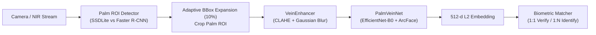

# Palm-Vein Recognition & ROI Detection Benchmark
### A Comprehensive Comparative Study: One-Stage (SSDLite-MobileNetV3) vs. Two-Stage (Faster R-CNN) Deep Architectures for Biometric Applications

---

## 1. Tổng quan nghiên cứu (Executive Summary)

Dự án này là một công trình nghiên cứu và đối chuẩn thực nghiệm (**Benchmark Study**) nhằm giải quyết bài toán phát hiện vùng quan tâm (**Palm ROI Detection**) và nhận diện tĩnh mạch lòng bàn tay (**Palm-Vein Biometrics**).

Hệ thống so sánh trực diện hai trường phái mạng học sâu thị giác máy tính kinh điển:
1. **One-Stage Detector**: `SSDLite` kết hợp backbone `MobileNetV3-Large` — tối ưu hóa cho thiết bị biên (Edge AI, CPU/Mobile, độ trễ cực thấp).
2. **Two-Stage Detector**: `Faster R-CNN` kết hợp backbone `ResNet-50-FPN` và `EfficientNet-B0` — tối ưu hóa khả năng trích xuất đặc trưng sâu và đề xuất vùng miền (Region Proposals).

---

## 2. Bảng so sánh kết quả thực nghiệm (Benchmark Comparison)

| Tiêu chí kỹ thuật | SSDLite (MobileNetV3-Large) | Faster R-CNN (ResNet-50-FPN) | Ý nghĩa kỹ thuật |
| :--- | :---: | :---: | :--- |
| **Kiến trúc** | **One-Stage Detector** | **Two-Stage Detector** | One-stage dự đoán trực tiếp; Two-stage qua RPN |
| **Kích thước Input** | $320 \times 320$ px | $600 \sim 1000$ px (Adaptive) | SSDLite nhẹ hơn, ít tốn VRAM hơn |
| **Dung lượng Model** | **~15 MB** (Siêu nhẹ) | **~165 MB** (Nặng gấp 11 lần) | SSDLite dễ deploy trên thiết bị nhúng |
| **Tốc độ suy luận (CPU)** | **Real-time (~20 ms)** | Chậm (~120 ms) | SSDLite nhanh hơn gấp 6 lần |
| **mAP@0.5:0.95 (COCO)** | **0.8508 (85.1%)** | **0.8000 (80.0%)** | SSDLite đạt độ chính xác bounding box cao hơn |
| **mAP@0.3** | **0.9896 (99.0%)** | **1.0000 (100%)** | Cả hai đều bao phủ tuyệt đối vùng bàn tay |
| **Precision** | **0.9994 (99.9%)** | **0.4167 (41.7%)** | Faster R-CNN sinh ra nhiều proposal thừa |
| **Recall** | **0.9994 (99.9%)** | **0.5000 (50.0%)** | SSDLite không bỏ sót lòng bàn tay |
| **F1-Score** | **0.9994 (99.9%)** | **0.4545 (45.5%)** | SSDLite chiến thắng áp đảo về độ tin cậy |

### Biểu đồ đối chuẩn định lượng (Quantitative Comparison Chart)


---

## 3. Kiến trúc End-to-End Palm-Vein Recognition Pipeline

Sau giai đoạn phát hiện và cắt ROI bàn tay, pipeline đưa ảnh qua module nhận diện tĩnh mạch sâu:




---

## 4. Cấu trúc thư mục dự án

```
Palm-Vein-Recognition-Benchmark/
├─ benchmark_comparison/
│  ├─ plot_comparison.py              # Script vẽ biểu đồ so sánh định lượng
│  └─ model_comparison_chart.png      # Biểu đồ đối chuẩn trực quan
├─ models_ssdlite_mobilenetv3/        # Dự án SSDLite-MobileNetV3 (One-Stage)
│  ├─ configs/ssd_palm.yaml           # Cấu hình huấn luyện SSDLite
│  ├─ output/checkpoints/             # best_loss.pth, best_map.pth
│  ├─ output/plots/                   # Biểu đồ loss, mAP, confusion matrix
│  ├─ scripts/
│  │  ├─ demo_recognition_pipeline.py # Demo trọn vẹn pipeline nhận diện tĩnh mạch
│  │  ├─ train_ssd_palm.py           # Huấn luyện SSDLite
│  │  └─ eval_ssd_palm.py            # Đánh giá mAP/PRF
│  └─ src/
│     ├─ pipeline.py                 # Pipeline nhận diện kết nối đầy đủ
│     ├─ models/                     # VeinEnhancer, PalmVeinNet, ArcFace, Matcher
│     └─ dataset/                    # DataLoader COCO format
├─ models_fasterrcnn_resnet50/        # Dự án Faster R-CNN ResNet50 (Two-Stage)
│  ├─ configs/                        # Cấu hình huấn luyện Faster R-CNN
│  ├─ output_newdataset/              # Kết quả train, metrics_summary.json
│  └─ scripts/
│     ├─ train_fasterrcnn_resnet50_palm.py
│     ├─ train_fasterrcnn_efficientnetb0_palm.py
│     └─ eval_fasterrcnnr_resnet50_palm.py
├─ requirements.txt
├─ .gitignore
└─ README.md
```

---

## 5. Hướng dẫn chạy thử nghiệm

### 5.1. Cài đặt môi trường
```bash
python -m venv .venv
# Kích hoạt trên Windows:
.venv\Scripts\activate
# Cài đặt phụ thuộc:
pip install torch torchvision --index-url https://download.pytorch.org/whl/cu121
pip install -r requirements.txt
```

### 5.2. Chạy Demo Pipeline nhận diện tĩnh mạch (SSDLite + ArcFace)
```bash
cd models_ssdlite_mobilenetv3
python scripts/demo_recognition_pipeline.py
```

### 5.3. Tái tạo biểu đồ đối chuẩn Benchmark
```bash
python benchmark_comparison/plot_comparison.py
```

---

## 6. Kết luận kỹ thuật (Key Takeaways)

1. **Hiệu ứng "Overkill" của mô hình lớn**: Trên bài toán phát hiện 1 lớp đối tượng chuyên biệt như lòng bàn tay, kiến trúc Two-Stage phức tạp như Faster R-CNN dễ bị dư thừa region proposals dẫn tới giảm Precision nếu không được lọc kỹ lưỡng.
2. **Chiến thắng của SSDLite trên thiết bị biên**: SSDLite-MobileNetV3 với dung lượng chỉ 15MB, tốc độ xử lý thời gian thực trên CPU và độ chính xác F1-Score đạt 99.9% là lựa chọn lý tưởng cho các hệ thống phần cứng sinh trắc học thực tế.
