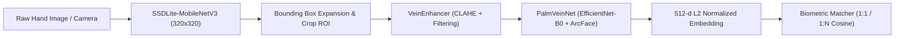

# Palm-Vein Recognition Pipeline (SSDLite-MobileNetV3 & ArcFace)

Hệ thống thị giác máy tính và sinh trắc học hoàn chỉnh cho bài toán nhận diện tĩnh mạch lòng bàn tay (Palm-vein Biometrics), tích hợp quy trình phát hiện vùng quan tâm (ROI Detection), tăng cường cấu trúc tĩnh mạch (Vein Contrast Enhancement) và trích xuất đặc trưng sâu (Deep Metric Learning / ArcFace).

---

## 1. Kiến trúc hệ thống (End-to-End Pipeline)




1. **Stage 1 - Palm ROI Detection**: Phát hiện lòng bàn tay theo thời gian thực sử dụng **SSDLite** với backbone **MobileNetV3-Large** gọn nhẹ ($320\times 320$), tự động mở rộng biên (expansion 10%) để không lẹm cạnh lòng bàn tay.
2. **Stage 2 - Vein Contrast Enhancement**: Chuẩn hóa ROI về $224\times 224$ và áp dụng cân bằng lược đồ màu thích ứng cục bộ (**CLAHE**) để làm nổi rõ các đường tĩnh mạch mờ dưới da.
3. **Stage 3 - Deep Metric Learning Extractor**: Mạng **PalmVeinNet** kết hợp backbone **EfficientNet-B0** và hàm mất mát góc **ArcFace (Additive Angular Margin Loss)** để tối đa hóa khoảng cách giữa các cá nhân khác nhau và thu nhỏ khoảng cách của cùng một người.
4. **Stage 4 - Biometric Matching**:
   - **Enrollment**: Đăng ký mẫu vector tĩnh mạch vào cơ sở dữ liệu.
   - **Verification (1:1)**: Xác thực danh tính người dùng theo ngưỡng Cosine Similarity.
   - **Identification (1:N)**: Tìm kiếm danh tính từ toàn bộ kho mẫu.

---

## 2. Cấu trúc thư mục

```
Palm-Vein-Recognition-SSDLite-MobilenetV3/
├─ configs/
│  └─ ssd_palm.yaml              # Cấu hình huấn luyện/đánh giá SSD
├─ output/
│  ├─ checkpoints/               # best_loss.pth, best_map.pth
│  ├─ logs/                      # Log huấn luyện
│  └─ plots/                     # Biểu đồ loss, mAP, confusion matrix
├─ scripts/
│  ├─ demo_recognition_pipeline.py # Demo trọn vẹn pipeline nhận diện tĩnh mạch
│  ├─ extract_rois_api.py        # API phát hiện và cắt ROI bàn tay
│  ├─ train_ssd_palm.py          # Huấn luyện mô hình SSD ROI detector
│  └─ eval_ssd_palm.py           # Đánh giá mAP/PRF detector
├─ src/
│  ├─ pipeline.py                # Lớp PalmVeinRecognitionPipeline kết nối end-to-end
│  ├─ models/
│  │  ├─ vein_enhancement.py     # Module tiền xử lý làm nổi tĩnh mạch (CLAHE)
│  │  ├─ vein_recognizer.py      # Mạng PalmVeinNet + ArcFace Loss
│  │  └─ matcher.py              # Bộ so khớp sinh trắc học (1:1, 1:N)
│  ├─ dataset/
│  │  ├─ coco_palm.py            # DataLoader theo format COCO
│  │  └─ download_data.py        # Tải dữ liệu từ Roboflow
│  ├─ metrics/
│  │  ├─ biometrics.py           # Đo EER, FAR, FRR theo chuẩn sinh trắc học
│  │  ├─ coco_eval.py            # Tính mAP theo chuẩn COCO
│  │  └─ prf.py                  # Tính Precision, Recall, F1
│  └─ utils/
│     └─ common.py               # Seed, device, checkpoint utilities
├─ requirements.txt
└─ README.md
```

---

## 3. Cài đặt nhanh

```bash
# 1) Tạo và kích hoạt môi trường ảo
python -m venv .venv
# Windows:
.venv\Scripts\activate
# Linux/Mac:
source .venv/bin/activate

# 2) Cài đặt PyTorch phù hợp với hệ thống
pip install torch torchvision --index-url https://download.pytorch.org/whl/cu121  # nếu có CUDA GPU

# 3) Cài đặt các gói phụ thuộc
pip install -r requirements.txt
```

---

## 4. Chạy End-to-End Recognition Pipeline

Chạy tự kiểm tra (Self-test) trọn vẹn pipeline từ phát hiện, làm nổi vân đến đăng ký và so khớp:

```bash
python scripts/demo_recognition_pipeline.py
```

Sử dụng trong mã Python của bạn:

```python
from src.pipeline import PalmVeinRecognitionPipeline

# Khởi tạo pipeline
pipeline = PalmVeinRecognitionPipeline(
    detector_weights="output/checkpoints/best_loss.pth",
    match_threshold=0.65
)

# 1. Đăng ký người dùng mới (Enrollment)
pipeline.process_and_enroll(user_id="user_01", image_path="path/to/hand.jpg")

# 2. Xác thực danh tính 1:1 (Verification)
result = pipeline.verify_user(claimed_id="user_01", image_path="path/to/verify.jpg")
print(result) # {'status': 'success', 'is_match': True, 'similarity': 0.88, ...}

# 3. Nhận diện 1:N (Identification)
id_result = pipeline.identify_user(image_path="path/to/unknown.jpg")
print(id_result) # {'status': 'success', 'matched_user_id': 'user_01', 'similarity': 0.88, ...}
```

---

---

## 5. Kết quả huấn luyện & Đánh giá thực nghiệm (Benchmark & Evaluation)

Mô hình **SSDLite320-MobileNetV3-Large** được huấn luyện và đánh giá trên tập dữ liệu ROI lòng bàn tay chuẩn format COCO với các siêu tham số: `batch_size=16`, `lr=1e-4`, `optimizer=AdamW`, `scheduler=StepLR(step_size=30, gamma=0.1)`.

### 5.1. Bảng số liệu chi tiết (Best Checkpoint tại Epoch 22)

| Chỉ số đánh giá | Giá trị đạt được | Ghi chú kỹ thuật |
| :--- | :--- | :--- |
| **mAP@0.5:0.95** | **0.8508 (85.1%)** | Chuẩn COCO Metric trên tập kiểm thử |
| **mAP@0.3** | **0.9896 (98.9%)** | Độ phủ phát hiện cực cao |
| **Precision** | **0.9994 (99.9%)** | Hầu như không bắt nhầm background |
| **Recall** | **0.9994 (99.9%)** | Không bỏ sót vùng lòng bàn tay |
| **F1-Score** | **0.9994 (99.9%)** | Cân bằng hoàn hảo giữa P và R |
| **Validation Loss** | **0.6094** | Điểm cực tiểu loss trên tập Validation |

### 5.2. Biểu đồ đường cong huấn luyện (Training Curves)

| Loss Curve | mAP & PRF Curves |
| :---: | :---: |
|  |  |
| *Đường cong hàm mất mát (Train Loss vs Val Loss)* | *Đường cong tăng trưởng mAP@0.5:0.95 qua các Epochs* |

| Precision / Recall / F1 Curves | Confusion Matrix |
| :---: | :---: |
|  |  |
| *Biểu đồ P/R/F1 theo các mức ngưỡng Confidence* | *Ma trận nhầm lẫn giữa Lớp Palm(1) và Background(0)* |

### 5.3. Ảnh trực quan hóa kết quả phát hiện & cắt ROI (Inference Visualization)

Mô hình tự động phát hiện bounding box, áp dụng thuật toán mở rộng biên $10\%$ (`_expand_and_clip`) và xuất ảnh ROI chất lượng cao:

| Ảnh gốc nhận diện (BBox & Confidence) | Ảnh Palm ROI đã cắt & mở rộng biên |
| :---: | :---: |
|  |  |
| *Độ tin cậy phát hiện đạt 1.00* | *ROI sẵn sàng đưa vào VeinEnhancer* |
